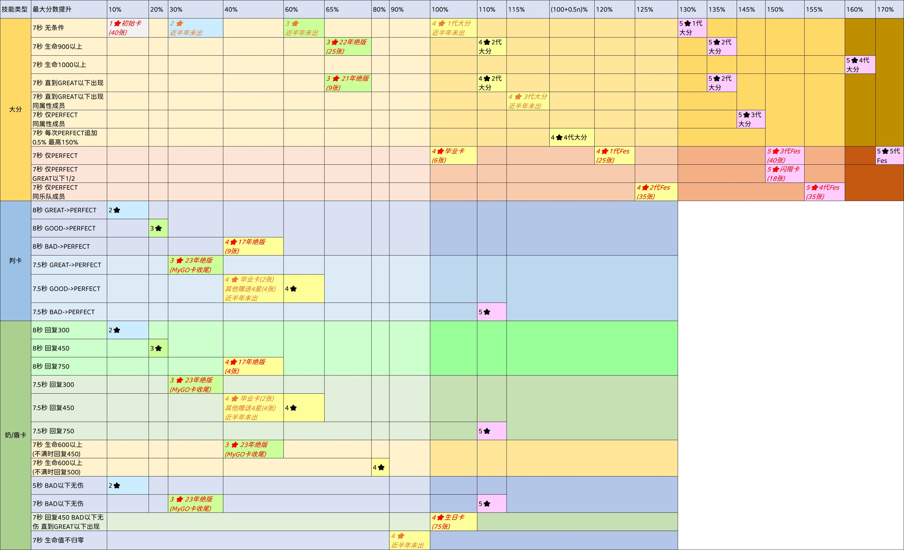

%%
主要参考：
[卡牌 | Bestdori! BanG Dream 少女乐团派对的最佳资源库](https://bestdori.com/info/cards)
[BanG Dream! 少女乐团派对！/游戏系统 - 萌娘百科 万物皆可萌的百科全书](https://zh.moegirl.org.cn/BanG_Dream!_%E5%B0%91%E5%A5%B3%E4%B9%90%E5%9B%A2%E6%B4%BE%E5%AF%B9%EF%BC%81/%E6%B8%B8%E6%88%8F%E7%B3%BB%E7%BB%9F#.E6.88.90.E5.91.98.E5.8D.A1.E7.89.87.E4.BF.A1.E6.81.AF)
成员卡片信息 > 卡牌技能详细信息表 [展开]
%%

## 技能类型 / 分数提升汇总表



## 日服技能卡出现顺序 _OLD VER. 2026.10_

> 技能简记规则：`[星级]分数;特殊技能;秒数`

| 时间          | 备注          | 类型                                                               | 技能简记                                                        | 最后日期                                                                                              |
| ----------- | ----------- | ---------------------------------------------------------------- | ----------------------------------------------------------- | ------------------------------------------------------------------------------------------------- |
| 2017 年 3 月  | *初始卡*       | <font color="#f79646">分卡</font>                                  | `[1]10;7`                                                   | [2023 年 9 月](https://bestdori.com/info/cards/1812/Taki-Shina-Rhythm-Re-Start)                     |
|             |             | <font color="#f79646">分卡</font>                                  | `[2]30;7`                                                   |                                                                                                   |
|             |             | <font color="#f79646">分卡</font>                                  | `[3]60;7`                                                   |                                                                                                   |
|             |             | <font color="#f79646">分卡</font>                                  | `[4]100;7`                                                  |                                                                                                   |
|             |             | <font color="#4f81bd">判卡</font>                                  | `[2]10;判great;8`                                            |                                                                                                   |
|             |             | <font color="#4f81bd">判卡</font>                                  | `[3]20;判good;8`                                             |                                                                                                   |
|             |             | <font color="#4f81bd">判卡</font>                                  | `[4]40;判bad;8`                                              | [2017 年 6 月](https://bestdori.com/info/cards/151/Hina-Hikawa-Important-Tanzaku)                   |
|             |             | <font color="#9bbb59">奶卡</font>                                  | `[2]10;奶300;8`                                              |                                                                                                   |
|             |             | <font color="#9bbb59">奶卡</font>                                  | `[3]20;奶450;8`                                              |                                                                                                   |
|             |             | <font color="#9bbb59">奶卡</font>                                  | `[4]40;奶750;8`                                              | [2017 年 7 月](https://bestdori.com/info/cards/157/Ako-Udagawa-Private-Nurse)                       |
| 2017 年 7 月  |             | <font color="#4f81bd">判卡</font>                                  | `[3]30;判great;7.5`                                          | [2023 年 9 月](https://bestdori.com/info/cards/1821/Soyo-Nagasaki-The-Calm-Mediator)                |
|             |             | <font color="#4f81bd">判卡</font>                                  | `[4]60;判good;7.5`                                           |                                                                                                   |
|             |             | <font color="#9bbb59">奶卡</font>                                  | `[3]30;奶300;7.5`                                            | [2023 年 9 月](https://bestdori.com/info/cards/1819/Anon-Chihaya-Someone-Who-Gets-Along-Well-With)  |
| 2017 年 11 月 |             | <font color="#f79646">条件大分</font>                                | `[3]65L(900),55;7`                                          | [2022 年 10 月](https://bestdori.com/info/cards/1638/Rui-Yashio-Argumentative-Demon)                |
|             |             | <font color="#f79646">条件大分</font>                                | `[4]110L(900),90;7`                                         |                                                                                                   |
| 2017 年 12 月 |             | <font color="#9bbb59">奶卡</font>                                  | `[4]60;奶450;7.5`                                            |                                                                                                   |
|             | **1 代 Fes** | <font color="#f79646">条件大分</font>                                | ~~`[4]115P;7`~~<br>`[4]120P;7`                              | [2019 年 12 月](https://bestdori.com/info/cards/831/Misaki-Okusawa-The-Other-Me)                    |
| 2018 年 11 月 |             | <font color="#9bbb59">奶</font> / <font color="#f79646">大分</font> | `[3]40L(600)/奶450;7`                                        | [2023 年 9 月](https://bestdori.com/info/cards/1820/Rana-Kaname-A-Kitten-Clawing-at-the-Guitar)     |
|             |             | <font color="#9bbb59">奶</font> / <font color="#f79646">大分</font> | `[4]80L(600)/奶500;7`                                        |                                                                                                   |
| 2018 年 12 月 |             | <font color="#f79646">条件大分</font>                                | `[3]65G,55;7`<br>                                           | [2021 年 7 月](https://bestdori.com/info/cards/1234/LOCK-Sharing-With-Friends)                      |
|             |             | <font color="#f79646">条件大分</font>                                | `[4]110G,90;7`                                              |                                                                                                   |
| 2019 年 1 月  |             | <font color="#4bacc6">盾卡</font>                                  | `[2]10;盾;5`                                                 |                                                                                                   |
| 2019 年 3 月  |             | <font color="#4bacc6">盾卡</font>                                  | `[3]30;盾;7`                                                 | [2023 年 9 月](https://bestdori.com/info/cards/1818/Tomori-Takamatsu-Mysterious-Little-Animal)      |
| 2020 年 3 月  | **2 代 Fes** | <font color="#f79646">条件大分</font>                                | `[4]125PB,110P;7`                                           | [2022 年 12 月](https://bestdori.com/info/cards/1670/PAREO-Well-Done-Too-Reona)                     |
|             |             | <font color="#f79646">条件大分</font>                                | `[4]115GT,95G,80;7`                                         |                                                                                                   |
| 2021 年 3 月  | *生日卡*       | <font color="#9bbb59">奶</font> + <font color="#4bacc6">盾</font>  | `[4]100G,40;盾;奶450;7`                                       | [2025 年 2 月](https://bestdori.com/info/cards/2163/Rana-Kaname-Hopeful-Birthday)                   |
| 2021 年 10 月 | *闪限卡*       | <font color="#f79646">条件大分</font>                                | ~~`[4]125P,0;7`~~<br>~~`[4]125P,1/2;7`~~<br>`[5]150P,1/2;7` | [2023 年 9 月](https://bestdori.com/info/cards/1834/Hagumi-Kitazawa-Flowers-Smiles-and-Fluff)       |
| 2021 年 11 月 |             | <font color="#f79646">条件大分</font>                                | `[4]100+0.5P;7`                                             |                                                                                                   |
|             |             | <font color="#8064a2">不死卡</font>                                 | `[4]90;不死;7`                                                |                                                                                                   |
| 2023 年 2 月  | *毕业卡*       | <font color="#f79646">条件大分</font>                                | `[4]100P;7`                                                 | [2023 年 3 月](https://bestdori.com/info/cards/1700/Maya-Yamato-Graduation)                         |
|             | *毕业卡*       | <font color="#4f81bd">判卡</font>                                  | `[4]40;判good;7.5`                                           |                                                                                                   |
|             | *毕业卡*       | <font color="#9bbb59">奶卡</font>                                  | `[4]40;奶450;7.5`                                            |                                                                                                   |
| 2023 年 3 月  |             | <font color="#f79646">大分</font>                                  | `[5]130;7`                                                  |                                                                                                   |
|             |             | <font color="#4f81bd">判卡</font>                                  | `[5]110;判bad;7.5`                                           |                                                                                                   |
|             |             | <font color="#9bbb59">奶卡</font>                                  | `[5]110;奶750;7.5`                                           |                                                                                                   |
|             | **3 代 Fes** | <font color="#f79646">条件大分</font>                                | `[5]150P;7`                                                 | [2025 年 2 月](https://bestdori.com/info/cards/2170/Tsukushi-Futaba-Playtime-with-the-Little-Birds) |
| 2025 年 3 月  |             | <font color="#f79646">条件大分</font>                                | `[5]135G,125;7`<br>                                         |                                                                                                   |
|             |             | <font color="#f79646">条件大分</font>                                | `[5]135L(900),125;7`                                        |                                                                                                   |
|             |             | <font color="#4bacc6">盾卡</font>                                  | `[5]110;盾;7`                                                |                                                                                                   |
|             | **4 代 Fes** | <font color="#f79646">条件大分</font>                                | `[5]155PB,145P;7`                                           | [2026 年 6 月](https://bestdori.com/info/cards/2480)                                                |
| 2026 年 5 月  |             | <font color="#f79646">条件大分</font>                                | `[5]145PT,130P;7`                                           |                                                                                                   |
| 2026 年 7 月  |             | <font color="#f79646">条件大分</font>                                | `[5]160L(1000),110;7`                                       |                                                                                                   |
|             | **5 代 Fes** | <font color="#f79646">条件大分</font>                                | `[5]170P;7`                                                 |                                                                                                   |

## 卡牌升星与技能变动 _OLD VER. 2026.10_

### 佐贺联动

| 卡牌名称                                                                                         | 原 4 星技能                                                                                | 升 5 星后的技能      |
| -------------------------------------------------------------------------------------------- | -------------------------------------------------------------------------------------- | -------------- |
| [丸山 彩 - 蓬松粉僵尸](https://bestdori.com/info/cards/1205/Aya-Maruyama-Fluffy-Pink-Zombie)         | 7.0 秒内 得分提升 80%。到 GREAT 以下出现为止得分提升 95%；发动者的队伍成员全部为 Cool 属性的情况下；到 GREAT 以下出现为止得分提升 115% | 7 秒内 得分提升 130% |
| [白鹭 千圣 - 职业意识僵尸](https://bestdori.com/info/cards/1206/Chisato-Shirasagi-Professional-Zombie) | 7 秒内 得分提升 90% 发动时若生命在 900 以上则得分提升 110%                                                 | 7 秒内 得分提升 130% |

%%
B 站搜索：
bangdream 佐贺联动
https://www.bilibili.com/video/BV1c94y197Gv/?t=30
%%

### 史莱姆联动

| 卡牌名称                                                                                     | 原 4 星技能                                | 升 5 星后的技能      |
| ---------------------------------------------------------------------------------------- | -------------------------------------- | -------------- |
| [仓田 真白 - 欢迎来到异世界！](https://bestdori.com/info/cards/1634/Mashiro-Kurata-In-Another-World) | 7 秒内 得分提升 90% 发动时若生命在 900 以上则得分提升 110% | 7 秒内 得分提升 130% |
| [二叶 筑紫 - 受到称赞之人](https://bestdori.com/info/cards/1635/Tsukushi-Futaba-The-Praised-One)   | 7 秒内 得分提升 90% 到 GREAT 以下出现为止 得分提升 110% | 7 秒内 得分提升 130% |

%%
B 站搜索：
bangdream 史莱姆联动
https://www.bilibili.com/video/BV1T14y1d7UF/?t=54
%%

### 闪限卡调整

| 大致时间        | 技能描述                                          |
| ----------- | --------------------------------------------- |
| 2021 年 10 月 | 7 秒内 仅在 PERFECT 时 得分提升 125% GREAT 及以下分数均为 0   |
| 2022 年 1 月  | 7 秒内 仅在 PERFECT 时 得分提升 125% GREAT 以下得分全部为 1/2 |
| 2023 年 1 月  | 7 秒内 仅在 PERFECT 时 得分提升 150% GREAT 以下得分全部为 1/2 |

%%
推特搜索：
from:bang_dream_gbp since:2021-10-01 until:2022-04-01 キラフェス
キラメキフェスティバル限定メンバーのスキル効果の上方修正を実施✨
https://x.com/bang_dream_gbp/status/1487024932764545025
🎸ガルパステーション #8 📺
https://x.com/bang_dream_gbp/status/1486896823222640640
关键词：
Garupa Station #8
https://www.bilibili.com/video/BV1qr4y1a7CK/?t=1797

推特搜索：
from:bang_dream_gbp since:2023-01-01 until:2023-04-01 キラフェス
超大型アップデート以降、★5 キラフェス限定メンバーが登場🌟
https://x.com/bang_dream_gbp/status/1612406197071810560
关键词：
少女乐团派对六周年超大型更新发表会
https://www.bilibili.com/video/BV1GG4y1A7pc/?t=4167

补充：
国服疑似先同步日服改 KiraFes 为 5 星，等到 5 星大版本更新后再变动技能？
参考：
2023-04-02 提到：国服的Kira Fes卡也被同步更新成五星卡了
[[提问] [国服] 关于bestdori上的五星卡 NGA玩家社区](https://bbs.nga.cn/read.php?tid=35851935)
2023-11-25 提到：这游戏是这版本才出的五星卡吗？
[萌新提问… 抽卡相关 NGA玩家社区](https://bbs.nga.cn/read.php?tid=38501760&rand=178#1)
补充：
或许 2023-04 的更新只是 bug（引用评论：设计之初就没想过同ID的卡各服有差异的情况）
至于从 4 月 到 11 月，当时的玩家是否一直顶着 KiraFes 的 5 星卡 bug？暂时搁置不再细究。
%%

### 1 代 Fes 调整

| 大致时间        | 技能描述                        |
| ----------- | --------------------------- |
| 2017 年 12 月 | 7 秒内 仅在 PERFECT 时 得分提升 115% |
| 2020 年 3 月  | 7 秒内 仅在 PERFECT 时 得分提升 120% |

%%
```markdown
游戏 bangdream 少女乐团派对中，kirafes（Kira Festival）闪限卡的技能，根据萌娘百科的记录，最早是 7 秒内 仅在 PERFECT 时 得分提升 125% GREAT 及以下分数均为 0，后面改成了 7 秒内 仅在 PERFECT 时得分提升 125%。GREAT 以下得分全部为 1/2，后面 5星卡出现后这张卡升级到 5星，技能又变成 7 秒内 仅在 PERFECT 时得分提升 150%。GREAT 以下得分全部为 1/2
但是时间太久，我很难找到与之有关的社区讨论历史，萌娘百科上面也没有相关引用
请针对上面这个，为我搜索寻找有关这个卡牌技能变更的社区讨论链接或者官方通告的链接，并尝试进一步搜索，游戏还有哪些卡牌技能有过变动，具体的讨论或公告链接（我需要准确的信息，请以讨论或链接为准，如果内容不够清晰如实回答，不要编造，如果没有明确的答案，请至少罗列一些可能存在相关信息且公开可搜索的社交媒体平台供我参考）
```
提到：
[[情報] 未來新技能相關以及舊技能調整 - 看板BanG_Dream - PTT網頁版](https://www.pttweb.cc/bbs/BanG_Dream/M.1583118894.A.951)
确定时间和版本：
2020 年 3 月 2 日前 v4.0.0
推特搜索：
from:bang_dream_gbp since:2020-02-28 until:2020-03-20
明日、21時から｢@ハロハピCiRCLE放送局 3周年直前SP」を生放送でお届けします‼️
https://x.com/bang_dream_gbp/status/1233587793852432385
关键词：
ハロハピ 手游3周年直前SP
https://www.bilibili.com/video/BV1VE41177fS/
未找到关于 Fes 卡技能调整的信息

推特搜索：
from:bang_dream_gbp since:2020-03-15 until:2020-04-30 "v4.0.0"
新技能登场❣
https://x.com/bang_dream_gbp/status/1239221409307484162
唯一相关信息只有这个新大分卡，和上述论坛链接提到的一致
论坛相关回复帖：
[Re: [情報] 未來新技能相關以及舊技能調整 - 看板BanG_Dream - PTT網頁版](https://www.pttweb.cc/bbs/BanG_Dream/M.1583120102.A.CF1)
改版的似乎不只有 1 代 Fes？看不明白原帖表达的含义，暂时搁置不论。
%%

### 国服小豆泥二期升星

| 卡牌名称                                                  | 原 4 星技能                                                                                  | 升 5 星后的技能      |
| ----------------------------------------------------- | ---------------------------------------------------------------------------------------- | -------------- |
| [丸山 彩 - 彩彩小豆泥](https://bestdori.com/info/cards/10029) | 7 秒内 得分提升 80%。到 GREAT 以下出现为止得分提升 95%；发动者的队伍成员全部为 Powerful 属性的情况下，到 GREAT 以下出现为止得分提升 115% | 7 秒内 得分提升 130% |

%%
B站搜索：
bangdream 小豆泥（筛选时间 2025.01.01 - 2025.06.01）
https://www.bilibili.com/video/BV1vaF8eYEY9/?t=69
（官号动态）小豆泥
https://www.bilibili.com/opus/1219590755127918625
%%

## 现象观察与数据分析 _DEL. 2026.11_

### 判卡集中比较

| 时间    | Great 以上                        | Good 以上                        | Bad 以上                          |
| ----- | ------------------------------- | ------------------------------ | ------------------------------- |
| 7.5 秒 | `[3]30;判great;7.5`<br>（2017/07） | `[4]60;判good;7.5`<br>（2017/07） |                                 |
|       |                                 | `[4]40;判good;7.5`<br>（2023/02） |                                 |
| 8 秒   | `[2]10;判great;8`<br>（2017/03）   | `[3]20;判good;8`<br>（2017/03）   | **`[4]40;判bad;8`**<br>（2017/03） |
|       |                                 |                                | `[5]110;判bad;7`<br>（2023/07）    |

### 奶卡集中比较

| 年份   | 回复 300                             | 回复 450                             | 回复 500               | 回复 750                |
| ---- | ---------------------------------- | ---------------------------------- | -------------------- | --------------------- |
| 2017 | `[2]10;奶300;8`<br>`[3]30;奶300;7.5` | `[3]20;奶450;8`<br>`[4]60;奶450;7.5` |                      | **`[4]40;奶750;8`**    |
| 2018 |                                    | `[3]40L(600)/奶450;7`               | `[4]80L(600)/奶500;7` |                       |
| 2019 |                                    |                                    |                      |                       |
| 2020 |                                    |                                    |                      |                       |
| 2021 |                                    | `[4]100G,40;盾;奶450;7`              |                      |                       |
| 2022 |                                    |                                    |                      |                       |
| 2023 |                                    | `[4]40;奶450;7.5`                   |                      | **`[5]110;奶750;7.5`** |

### 盾卡与不死卡

| 时间  | 盾卡                                                       | 不死卡          |
| --- | -------------------------------------------------------- | ------------ |
| 5 秒 | `[2]10;盾;5`                                              |              |
| 7 秒 | `[3]30;盾;7`<br>**`[4]100G,40;盾;奶450;7`**<br>`[5]110;盾;7` | `[4]90;不死;7` |

### MyGO 收尾的卡

| 技能                                         | 最后一张 MyGO 卡                                                                                             | 上一张卡                                                                                       | 出现时间       |
| ------------------------------------------ | ------------------------------------------------------------------------------------------------------- | ------------------------------------------------------------------------------------------ | ---------- |
| 7.5 秒内 GREAT 变为 PERFECT 得分提升 30            | [长崎 爽世 - 冷静的调停者](https://bestdori.com/info/cards/1821/Soyo-Nagasaki-The-Calm-Mediator)                  | [大和 麻弥 - 紧张的选择](https://bestdori.com/info/cards/1630/Maya-Yamato-Nail-Biting-Choice)       | 2022/10/20 |
| 生命回复 300 7.5 秒内 得分提升 30%                   | [千早 爱音 - 要搞好关系的是……](https://bestdori.com/info/cards/1819/Anon-Chihaya-Someone-Who-Gets-Along-Well-With) | [二叶 筑紫 - 火候很完美！](https://bestdori.com/info/cards/1684/Tsukushi-Futaba-Perfectly-Baked)     | 2023/1/31  |
| 发动时若生命在 600 以上则 7 秒内 得分提升 40%。若生命不满 600 时 生命回复 450 | [要 乐奈 - 拨弄琴弦的猫](https://bestdori.com/info/cards/1820/Rana-Kaname-A-Kitten-Clawing-at-the-Guitar)        | [松原 花音 - 与捣蛋猫咪的攻防战](https://bestdori.com/info/cards/1511/Kanon-Matsubara-vs-Naughty-Kitty) | 2022/5/11  |
| 7 秒内 BAD 以下时生命不会减少 得分提升 30%                   | [高松 灯 - 不可思议的小动物](https://bestdori.com/info/cards/1818/Tomori-Takamatsu-Mysterious-Little-Animal)       | [大和 麻弥 - 即使没有言语](https://bestdori.com/info/cards/1651/Maya-Yamato-Even-without-Words)      | 2022/11/30 |

### 除毕业卡外的 4 星报酬卡

| 技能                                  | 卡牌                                                                                             | 类型        | 时间         |
| ----------------------------------- | ---------------------------------------------------------------------------------------------- | --------- | ---------- |
| 7.5 秒内 GOOD 以上全部变为 PERFECT 得分提升 40％ | [白鹭 千圣 - 新的校园](https://bestdori.com/info/cards/1761/Chisato-Shirasagi-A-New-Place-of-Learning) | 活动        | 2023/6/21  |
|                                     | [牛込 里美 - 胆怯的恶魔猎人·里美](https://bestdori.com/info/cards/1767/Rimi-Ushigome-Cowardly-Devil-Hunter) | 活动（电锯人联动） | 2023/6/30  |
|                                     | [宇田川 亚子 - 帮助我的是](https://bestdori.com/info/cards/2320/Ako-Udagawa-The-One-Who-Saved-Me)        | 活动（三丽鸥联动） | 2025/11/10 |
|                                     | [LOCK - 活力全开即兴演奏！](https://bestdori.com/info/cards/2325/LOCK-Lively-JAM)                       | 活动（三丽鸥联动） | 2025/11/20 |
| 生命回复 450 7.5 秒内 得分提升 40%            | [今井 莉莎 - 彻底地调查？](https://bestdori.com/info/cards/1732/Lisa-Imai-Thorough-Research)             | 活动        | 2023/4/29  |
|                                     | [八潮 瑠唯 - 恶魔猎人的调停者·瑠唯](https://bestdori.com/info/cards/1766/Rui-Yashio-Harmony-Devil-Hunter)    | 活动（电锯人联动） | 2023/6/30  |
|                                     | [市谷 有咲 - 被卷入一场野餐](https://bestdori.com/info/cards/2319/Arisa-Ichigaya-Rolled-Up-Into-a-Picnic) | 活动（三丽鸥联动） | 2025/11/10 |
|                                     | [松原 花音 - 相处融洽的两位鼓手](https://bestdori.com/info/cards/2324/Kanon-Matsubara-Friendly-Twin-Drums)  | 活动（三丽鸥联动） | 2025/11/20 |

### 闪限卡调整前后与同类卡比较

| 条件       | 100%    | 110%    | 115%        | 120%      | 125%      | 130%    | 135%    | 145%    | 150%      | 155%      |
| -------- | ------- | ------- | ----------- | --------- | --------- | ------- | ------- | ------- | --------- | --------- |
| 无        | 4⭐1 代大分 |         |             |           |           | 5⭐1 代大分 |         |         |           |           |
| `L(900)` |         | 4⭐2 代大分 |             |           |           |         | 5⭐2 代大分 |         |           |           |
| `G`      |         | 4⭐2 代大分 |             |           |           |         | 5⭐2 代大分 |         |           |           |
| `GT`     |         |         | 4⭐3 代大分     |           |           |         |         |         |           |           |
| `PT`     |         |         |             |           |           |         |         | 5⭐3 代大分 |           |           |
| `P`      | 4⭐毕业卡   |         | *4⭐1 代 Fes* | 4⭐1 代 Fes |           |         |         |         | 5⭐3 代 Fes |           |
| `P(0)`   |         |         |             |           | *4⭐闪限*    |         |         |         |           |           |
| `P(1/2)` |         |         |             |           | **4⭐闪限**  |         |         |         | **5⭐闪限**  |           |
| `PB`     |         |         |             |           | 4⭐2 代 Fes |         |         |         |           | 5⭐4 代 Fes |

## 补充：*以上 / 以下* 包含自身 _DEL. 2026.11_

- 到 GREAT *以下* 出现为止：要求必须 PERFECT，直到第一个 GREAT 或更低判定出现前
- GREAT *以下* 得分全部为 1/2：只有 PERFECT 加分，所有 GREAT 或更低判定得分 -50%

%%
贴吧搜索：
（bangdream 吧）great 以下
[great以下出现为止135 技能，包括great吗-百度贴吧](https://tieba.baidu.com/p/11212959276?fr=undefined)
[立希的技能求解-百度贴吧](https://tieba.baidu.com/p/10121275980?fr=undefined)
[有大手子解答一下吗-百度贴吧](https://tieba.baidu.com/p/10056509175?fr=undefined)
[闪限对比梦限，究竟是正提升还是负提升？-百度贴吧](https://tieba.baidu.com/p/9188672266?share=9105&fr=sharewise&see_lz=0&share_from=post&sfc=copy&client_type=2&client_version=12.89.1.0&st=1758366037&is_video=false&unique=89EE1E6A07C4C0355E0396D4C71BDC41)
%%

## 附录：Bestdori 的技能列表 _OLD VER. 2026.10_

<select>
<option value="0">任意</option>
<option value="1">
	7秒内 得分提升10%
</option><option value="2">
	7秒内 得分提升30%
</option><option value="3">
	7秒内 得分提升60%
</option><option value="4">
	7秒内 得分提升100%
</option><option value="5">
	8秒内 GREAT变为PERFECT 得分提升10%
</option><option value="6">
	8秒内 GOOD以上全部变为PERFECT 得分提升20%
</option><option value="7">
	8秒内 BAD以上全部变为PERFECT 得分提升40%
</option><option value="8">
	生命回复（300） 8秒内 得分提升10%
</option><option value="9">
	生命回复（450） 8秒内 得分提升20%
</option><option value="10">
	生命回复（750） 8秒内 得分提升40%
</option><option value="11">
	7.5秒内 GREAT变为PERFECT 得分提升30%
</option><option value="12">
	7.5秒内 GOOD以上全部变为PERFECT 得分提升60%
</option><option value="13">
	生命回复300 7.5秒内 得分提升30%
</option><option value="14">
	生命回复450 7.5秒内 得分提升60%
</option><option value="15">
	生命回复300 7.5秒内 GREAT变为PERFECT
</option><option value="16">
	生命回复450 7.5秒内 GOOD以上全部变为PERFECT
</option><option value="17">
	7秒内 得分提升55% 发动时若生命在900以上则得分提升65%
</option><option value="18">
	7秒内 得分提升90% 发动时若生命在900以上则得分提升110%
</option><option value="20">
	7秒内 仅在PERFECT时 得分提升120%
</option><option value="21">
	发动时若生命在600以上则7秒内 得分提升40%。若生命不满600时 生命回复450
</option><option value="22">
	发动时若生命在600以上则7秒内 得分提升80%。若生命不满600时 生命回复500
</option><option value="23">
	5秒内 BAD以下时生命不会减少 得分提升10%
</option><option value="24">
	7秒内 BAD以下时生命不会减少 得分提升30%
</option><option value="25">
	7秒内 得分提升55% 到GREAT以下出现为止 得分提升65%
</option><option value="26">
	7秒内 得分提升90% 到GREAT以下出现为止 得分提升110%
</option><option value="27">
	7秒内 仅在PERFECT时 得分提升110%。发动者的队伍编队内仅有Poppin'Party乐队成员的情况下，得分提升125%
</option><option value="28">
	7秒内 仅在PERFECT时 得分提升110%。发动者的队伍编队内仅有Afterglow乐队成员的情况下，得分提升125%
</option><option value="29">
	7秒内 仅在PERFECT时 得分提升110%。发动者的队伍编队内仅有Pastel＊Palettes乐队成员的情况下，得分提升125%
</option><option value="30">
	7秒内 仅在PERFECT时 得分提升110%。发动者的队伍编队内仅有Roselia乐队成员的情况下，得分提升125%
</option><option value="31">
	7秒内 仅在PERFECT时 得分提升110%。发动者的队伍编队内仅有Hello, Happy World! 乐队成员的情况下，得分提升125%
</option><option value="32">
	7秒内 仅在PERFECT时 得分提升110%。发动者的队伍编队内仅有Morfonica乐队成员的情况下，得分提升125%
</option><option value="33">
	7秒内 仅在PERFECT时 得分提升100%。发动者的队伍成员全部为Happy属性的情况下，得分提升125%
</option><option value="34">
	7秒内 仅在PERFECT时 得分提升100%。发动者的队伍成员全部为Cool属性的情况下，得分提升125%
</option><option value="35">
	7秒内 仅在PERFECT时 得分提升100%。发动者的队伍成员全部为Powerful属性的情况下，得分提升125%
</option><option value="36">
	7秒内 仅在PERFECT时 得分提升100%。发动者的队伍成员全部为Pure属性的情况下，得分提升125%
</option><option value="37">
	7秒内 得分提升80%。到GREAT以下出现为止得分提升95%；发动者的队伍编队内仅有Poppin'Party乐队成员的情况下，到GREAT以下出现为止得分提升115%
</option><option value="38">
	7秒内 得分提升80%。到GREAT以下出现为止得分提升95%；发动者的队伍编队内仅有Afterglow乐队成员的情况下，到GREAT以下出现为止得分提升115%
</option><option value="39">
	7秒内 得分提升80%。到GREAT以下出现为止得分提升95%；发动者的队伍编队内仅有Pastel＊Palettes乐队成员的情况下，到GREAT以下出现为止得分提升115%
</option><option value="40">
	7秒内 得分提升80%。到GREAT以下出现为止得分提升95%；发动者的队伍编队内仅有Roselia乐队成员的情况下，到GREAT以下出现为止得分提升115%
</option><option value="41">
	7秒内 得分提升80%。到GREAT以下出现为止得分提升95%；发动者的队伍编队内仅有Hello, Happy World! 乐队成员的情况下，到GREAT以下出现为止得分提升115%
</option><option value="42">
	7秒内 得分提升80%。到GREAT以下出现为止得分提升95%；发动者的队伍编队内仅有Morfonica乐队成员的情况下，到GREAT以下出现为止得分提升115%
</option><option value="43">
	7秒内 得分提升80%。到GREAT以下出现为止得分提升95%；发动者的队伍成员全部为Happy属性的情况下，到GREAT以下出现为止得分提升115%
</option><option value="44">
	7秒内 得分提升80%。到GREAT以下出现为止得分提升95%；发动者的队伍成员全部为Cool属性的情况下，到GREAT以下出现为止得分提升115%
</option><option value="45">
	7秒内 得分提升80%。到GREAT以下出现为止得分提升95%；发动者的队伍成员全部为Powerful属性的情况下，到GREAT以下出现为止得分提升115%
</option><option value="46">
	7秒内 得分提升80%。到GREAT以下出现为止得分提升95%；发动者的队伍成员全部为Pure属性的情况下，到GREAT以下出现为止得分提升115%
</option><option value="47">
	7秒内 得分提升80%。发动者的队伍编队内仅有Poppin'Party乐队成员的情况下，得分提升105%
</option><option value="48">
	7秒内 得分提升80%。发动者的队伍编队内仅有Afterglow乐队成员的情况下，得分提升105%
</option><option value="49">
	7秒内 得分提升80%。发动者的队伍编队内仅有Pastel＊Palettes乐队成员的情况下，得分提升105%
</option><option value="50">
	7秒内 得分提升80%。发动者的队伍编队内仅有Roselia乐队成员的情况下，得分提升105%
</option><option value="51">
	7秒内 得分提升80%。发动者的队伍编队内仅有Hello, Happy World! 乐队成员的情况下，得分提升105%
</option><option value="52">
	7秒内 得分提升80%。发动者的队伍编队内仅有Morfonica乐队成员的情况下，得分提升105%
</option><option value="53">
	7秒内 得分提升80%。发动者的队伍成员全部为Happy属性的情况下，得分提升105%
</option><option value="54">
	7秒内 得分提升80%。发动者的队伍成员全部为Cool属性的情况下，得分提升105%
</option><option value="55">
	7秒内 得分提升80%。发动者的队伍成员全部为Powerful属性的情况下，得分提升105%
</option><option value="56">
	7秒内 得分提升80%。发动者的队伍成员全部为Pure属性的情况下，得分提升105%
</option><option value="57">
	生命回复450 7秒内 BAD以下时不会减少生命。且7秒内 得分提升40% 到GREAT以下出现为止得分提升100%
</option><option value="58">
	7秒内 仅在PERFECT时，得分提升110%。发动者的队伍编队内仅有RAISE A SUILEN乐队成员的情况下，仅在PERFECT时，得分提升125%
</option><option value="59">
	7秒内 仅在PERFECT时 得分提升125% GREAT及以下分数均为0
</option><option value="60">
	7秒内 得分提升90%，即使受到伤害生命值也不会变为0
</option><option value="61">
	7秒内 得分提升100%，并且在每次PERFECT时，得分追加提升0.5%（最大150%）
</option><option value="62">
	7秒内 仅在PERFECT时得分提升125%。GREAT以下得分全部为1/2
</option><option value="63">
	7秒内 仅在PERFECT时得分提升100%
</option><option value="64">
	7.5秒内 GOOD以上全部变为PERFECT 得分提升40％
</option><option value="65">
	生命回复450 7.5秒内 得分提升40%
</option><option value="66">
	7秒内 得分提升130%
</option><option value="67">
	7.5秒内 BAD以上全部变为PERFECT 得分提升110％
</option><option value="68">
	生命回复750 7.5秒内 得分提升110%
</option><option value="69">
	7秒内 仅在PERFECT时得分提升150%
</option><option value="70">
	7秒内 仅在PERFECT时得分提升150%。GREAT以下得分全部为1/2
</option><option value="71">
	7秒内 得分提升125% 到GREAT以下出现为止 得分提升135%
</option><option value="72">
	7秒内 得分提升125% 发动时若生命在900以上则得分提升135%
</option><option value="73">
	7秒内 BAD以下时生命不会减少 得分提升110%
</option><option value="74">
	7秒内 仅在PERFECT时 得分提升145%。发动者的队伍编队内仅有Poppin'Party乐队成员的情况下，得分提升155%
</option><option value="75">
	7秒内 仅在PERFECT时 得分提升145%。发动者的队伍编队内仅有Afterglow乐队成员的情况下，得分提升155%
</option><option value="76">
	7秒内 仅在PERFECT时 得分提升145%。发动者的队伍编队内仅有Pastel＊Palettes乐队成员的情况下，得分提升155%
</option><option value="77">
	7秒内 仅在PERFECT时 得分提升145%。发动者的队伍编队内仅有Roselia乐队成员的情况下，得分提升155%
</option><option value="78">
	7秒内 仅在PERFECT时 得分提升145%。发动者的队伍编队内仅有Hello, Happy World! 乐队成员的情况下，得分提升155%
</option><option value="79">
	7秒内 仅在PERFECT时 得分提升145%。发动者的队伍编队内仅有Morfonica乐队成员的情况下，得分提升155%
</option><option value="80">
	7秒内 仅在PERFECT时 得分提升145%。发动者的队伍编队内仅有RAISE A SUILEN乐队成员的情况下，得分提升155%
</option><option value="81">
	7秒内 仅在PERFECT时 得分提升145%。发动者的队伍编队内仅有MyGO!!!!!乐队成员的情况下，得分提升155%
</option><option value="82">
	7秒間 スコアが110%UP、発動時に自分のライフが1000以上の場合はスコアが160%UPする
</option><option value="83">
	7秒間 PERFECTのときのみ、スコアが170%UPする
</option><option value="84">
	7秒間 PERFECTのときのみ、スコアが130%UP。発動者のバンド編成がハッピータイプのみの場合はPERFECTのときのみ、スコアが145%UP
</option><option value="85">
	7秒間 PERFECTのときのみ、スコアが130%UP。発動者のバンド編成がクールタイプのみの場合はPERFECTのときのみ、スコアが145%UP
</option><option value="86">
	7秒間 PERFECTのときのみ、スコアが130%UP。発動者のバンド編成がパワフルタイプのみの場合はPERFECTのときのみ、スコアが145%UP
</option><option value="87">
	7秒間 PERFECTのときのみ、スコアが130%UP。発動者のバンド編成がピュアタイプのみの場合はPERFECTのときのみ、スコアが145%UP
</option>
</select>

### _SKIP SELECT_

> [!info] 补充说明
>
> - **粗体**：绝版或出完
> - *斜体*：近半年无新卡
> - ~~删除线~~：当前游戏版本中并不存在该技能

1. 【⭐】**7 秒内 得分提升 10%**
2. 【⭐⭐】*7 秒内 得分提升 30%*
3. 【⭐⭐⭐】*7 秒内 得分提升 60%*
4. 【⭐⭐⭐⭐】*7 秒内 得分提升 100%*
5. 【⭐⭐】8 秒内 GREAT 变为 PERFECT 得分提升 10%
6. 【⭐⭐⭐】8 秒内 GOOD 以上全部变为 PERFECT 得分提升 20%
7. 【⭐⭐⭐⭐】**8 秒内 BAD 以上全部变为 PERFECT 得分提升 40%**
8. 【⭐⭐】生命回复（300） 8 秒内 得分提升 10%
9. 【⭐⭐⭐】生命回复（450） 8 秒内 得分提升 20%
10. 【⭐⭐⭐⭐】**生命回复（750） 8 秒内 得分提升 40%**
11. 【⭐⭐⭐】**7.5 秒内 GREAT 变为 PERFECT 得分提升 30%**
12. 【⭐⭐⭐⭐】7.5 秒内 GOOD 以上全部变为 PERFECT 得分提升 60%
13. 【⭐⭐⭐】**生命回复 300 7.5 秒内 得分提升 30%**
14. 【⭐⭐⭐⭐】生命回复 450 7.5 秒内 得分提升 60%
15. ~~生命回复 300 7.5 秒内 GREAT 变为 PERFECT~~
16. ~~生命回复 450 7.5 秒内 GOOD 以上全部变为 PERFECT~~
17. 【⭐⭐⭐】**7 秒内 得分提升 55% 发动时若生命在 900 以上则得分提升 65%**
18. 【⭐⭐⭐⭐】7 秒内 得分提升 90% 发动时若生命在 900 以上则得分提升 110%
19. 【⭐⭐⭐⭐】**7 秒内 仅在 PERFECT 时 得分提升 120%**
20. 【⭐⭐⭐】**发动时若生命在 600 以上则 7 秒内 得分提升 40%。若生命不满 600 时 生命回复 450**
21. 【⭐⭐⭐⭐】发动时若生命在 600 以上则 7 秒内 得分提升 80%。若生命不满 600 时 生命回复 500
22. 【⭐⭐】5 秒内 BAD 以下时生命不会减少 得分提升 10%
23. 【⭐⭐⭐】**7 秒内 BAD 以下时生命不会减少 得分提升 30%**
24. 【⭐⭐⭐】**7 秒内 得分提升 55% 到 GREAT 以下出现为止 得分提升 65%**
25. 【⭐⭐⭐⭐】7 秒内 得分提升 90% 到 GREAT 以下出现为止 得分提升 110%
26. 【⭐⭐⭐⭐】**7 秒内 仅在 PERFECT 时 得分提升 110%。发动者的队伍编队内仅有 Poppin'Party 乐队成员的情况下，得分提升 125%**
27. 【⭐⭐⭐⭐】**7 秒内 仅在 PERFECT 时 得分提升 110%。发动者的队伍编队内仅有 Afterglow 乐队成员的情况下，得分提升 125%**
28. 【⭐⭐⭐⭐】**7 秒内 仅在 PERFECT 时 得分提升 110%。发动者的队伍编队内仅有 Pastel＊Palettes 乐队成员的情况下，得分提升 125%**
29. 【⭐⭐⭐⭐】**7 秒内 仅在 PERFECT 时 得分提升 110%。发动者的队伍编队内仅有 Roselia 乐队成员的情况下，得分提升 125%**
30. 【⭐⭐⭐⭐】**7 秒内 仅在 PERFECT 时 得分提升 110%。发动者的队伍编队内仅有 Hello, Happy World! 乐队成员的情况下，得分提升 125%**
31. 【⭐⭐⭐⭐】**7 秒内 仅在 PERFECT 时 得分提升 110%。发动者的队伍编队内仅有 Morfonica 乐队成员的情况下，得分提升 125%**
32. ~~7 秒内 仅在 PERFECT 时 得分提升 100%。发动者的队伍成员全部为 Happy 属性的情况下，得分提升 125%~~
33. ~~7 秒内 仅在 PERFECT 时 得分提升 100%。发动者的队伍成员全部为 Cool 属性的情况下，得分提升 125%~~
34. ~~7 秒内 仅在 PERFECT 时 得分提升 100%。发动者的队伍成员全部为 Powerful 属性的情况下，得分提升 125%~~
35. ~~7 秒内 仅在 PERFECT 时 得分提升 100%。发动者的队伍成员全部为 Pure 属性的情况下，得分提升 125%~~
36. ~~7 秒内 得分提升 80%。到 GREAT 以下出现为止得分提升 95%；发动者的队伍编队内仅有 Poppin'Party 乐队成员的情况下，到 GREAT 以下出现为止得分提升 115%~~
37. ~~7 秒内 得分提升 80%。到 GREAT 以下出现为止得分提升 95%；发动者的队伍编队内仅有 Afterglow 乐队成员的情况下，到 GREAT 以下出现为止得分提升 115%~~
38. ~~7 秒内 得分提升 80%。到 GREAT 以下出现为止得分提升 95%；发动者的队伍编队内仅有 Pastel＊Palettes 乐队成员的情况下，到 GREAT 以下出现为止得分提升 115%~~
39. ~~7 秒内 得分提升 80%。到 GREAT 以下出现为止得分提升 95%；发动者的队伍编队内仅有 Roselia 乐队成员的情况下，到 GREAT 以下出现为止得分提升 115%~~
40. ~~7 秒内 得分提升 80%。到 GREAT 以下出现为止得分提升 95%；发动者的队伍编队内仅有 Hello, Happy World! 乐队成员的情况下，到 GREAT 以下出现为止得分提升 115%~~
41. ~~7 秒内 得分提升 80%。到 GREAT 以下出现为止得分提升 95%；发动者的队伍编队内仅有 Morfonica 乐队成员的情况下，到 GREAT 以下出现为止得分提升 115%~~
42. 【⭐⭐⭐⭐】*7 秒内 得分提升 80%。到 GREAT 以下出现为止得分提升 95%；发动者的队伍成员全部为 Happy 属性的情况下，到 GREAT 以下出现为止得分提升 115%*
43. 【⭐⭐⭐⭐】*7 秒内 得分提升 80%。到 GREAT 以下出现为止得分提升 95%；发动者的队伍成员全部为 Cool 属性的情况下，到 GREAT 以下出现为止得分提升 115%*
44. 【⭐⭐⭐⭐】*7 秒内 得分提升 80%。到 GREAT 以下出现为止得分提升 95%；发动者的队伍成员全部为 Powerful 属性的情况下，到 GREAT 以下出现为止得分提升 115%*
45. 【⭐⭐⭐⭐】*7 秒内 得分提升 80%。到 GREAT 以下出现为止得分提升 95%；发动者的队伍成员全部为 Pure 属性的情况下，到 GREAT 以下出现为止得分提升 115%*
46. ~~7 秒内 得分提升 80%。发动者的队伍编队内仅有 Poppin'Party 乐队成员的情况下，得分提升 105%~~
47. ~~7 秒内 得分提升 80%。发动者的队伍编队内仅有 Afterglow 乐队成员的情况下，得分提升 105%~~
48. ~~7 秒内 得分提升 80%。发动者的队伍编队内仅有 Pastel＊Palettes 乐队成员的情况下，得分提升 105%~~
49. ~~7 秒内 得分提升 80%。发动者的队伍编队内仅有 Roselia 乐队成员的情况下，得分提升 105%~~
50. ~~7 秒内 得分提升 80%。发动者的队伍编队内仅有 Hello, Happy World! 乐队成员的情况下，得分提升 105%~~
51. ~~7 秒内 得分提升 80%。发动者的队伍编队内仅有 Morfonica 乐队成员的情况下，得分提升 105%~~
52. ~~7 秒内 得分提升 80%。发动者的队伍成员全部为 Happy 属性的情况下，得分提升 105%~~
53. ~~7 秒内 得分提升 80%。发动者的队伍成员全部为 Cool 属性的情况下，得分提升 105%~~
54. ~~7 秒内 得分提升 80%。发动者的队伍成员全部为 Powerful 属性的情况下，得分提升 105%~~
55. ~~7 秒内 得分提升 80%。发动者的队伍成员全部为 Pure 属性的情况下，得分提升 105%~~
56. 【⭐⭐⭐⭐】**生命回复 450 7 秒内 BAD 以下时不会减少生命。且 7 秒内 得分提升 40% 到 GREAT 以下出现为止得分提升 100%**
57. 【⭐⭐⭐⭐】**7 秒内 仅在 PERFECT 时，得分提升 110%。发动者的队伍编队内仅有 RAISE A SUILEN 乐队成员的情况下，仅在 PERFECT 时，得分提升 125%**
58. ~~7 秒内 仅在 PERFECT 时 得分提升 125% GREAT 及以下分数均为 0~~
59. 【⭐⭐⭐⭐】*7 秒内 得分提升 90%，即使受到伤害生命值也不会变为 0*
60. 【⭐⭐⭐⭐】7 秒内 得分提升 100%，并且在每次 PERFECT 时，得分追加提升 0.5%（最大 150%）
61. ~~7 秒内 仅在 PERFECT 时得分提升 125%。GREAT 以下得分全部为 1/2~~
62. 【⭐⭐⭐⭐】**7 秒内 仅在 PERFECT 时得分提升 100%**
63. 【⭐⭐⭐⭐】**7.5 秒内 GOOD 以上全部变为 PERFECT 得分提升 40％**
64. 【⭐⭐⭐⭐】**生命回复 450 7.5 秒内 得分提升 40%**
65. 【⭐⭐⭐⭐⭐】7 秒内 得分提升 130%
66. 【⭐⭐⭐⭐⭐】7.5 秒内 BAD 以上全部变为 PERFECT 得分提升 110％
67. 【⭐⭐⭐⭐⭐】生命回复 750 7.5 秒内 得分提升 110%
68. 【⭐⭐⭐⭐⭐】**7 秒内 仅在 PERFECT 时得分提升 150%**
69. 【⭐⭐⭐⭐⭐】**7 秒内 仅在 PERFECT 时得分提升 150%。GREAT 以下得分全部为 1/2**
70. 【⭐⭐⭐⭐⭐】7 秒内 得分提升 125% 到 GREAT 以下出现为止 得分提升 135%
71. 【⭐⭐⭐⭐⭐】7 秒内 得分提升 125% 发动时若生命在 900 以上则得分提升 135%
72. 【⭐⭐⭐⭐⭐】7 秒内 BAD 以下时生命不会减少 得分提升 110%
73. 【⭐⭐⭐⭐⭐】**7 秒内 仅在 PERFECT 时 得分提升 145%。发动者的队伍编队内仅有 Poppin'Party 乐队成员的情况下，得分提升 155%**
74. 【⭐⭐⭐⭐⭐】**7 秒内 仅在 PERFECT 时 得分提升 145%。发动者的队伍编队内仅有 Afterglow 乐队成员的情况下，得分提升 155%**
75. 【⭐⭐⭐⭐⭐】**7 秒内 仅在 PERFECT 时 得分提升 145%。发动者的队伍编队内仅有 Pastel＊Palettes 乐队成员的情况下，得分提升 155%**
76. 【⭐⭐⭐⭐⭐】**7 秒内 仅在 PERFECT 时 得分提升 145%。发动者的队伍编队内仅有 Roselia 乐队成员的情况下，得分提升 155%**
77. 【⭐⭐⭐⭐⭐】**7 秒内 仅在 PERFECT 时 得分提升 145%。发动者的队伍编队内仅有 Hello, Happy World! 乐队成员的情况下，得分提升 155%**
78. 【⭐⭐⭐⭐⭐】**7 秒内 仅在 PERFECT 时 得分提升 145%。发动者的队伍编队内仅有 Morfonica 乐队成员的情况下，得分提升 155%**
79. 【⭐⭐⭐⭐⭐】**7 秒内 仅在 PERFECT 时 得分提升 145%。发动者的队伍编队内仅有 RAISE A SUILEN 乐队成员的情况下，得分提升 155%**
80. ~~7 秒内 仅在 PERFECT 时 得分提升 145%。发动者的队伍编队内仅有 MyGO!!!!!乐队成员的情况下，得分提升 155%~~
81. 【⭐⭐⭐⭐⭐】7 秒間 スコアが 110%UP、発動時に自分のライフが 1000 以上の場合はスコアが 160%UP する（Life 1000 以上）
82. 【⭐⭐⭐⭐⭐】7 秒間 PERFECT のときのみ、スコアが 170%UP する
83. 【⭐⭐⭐⭐⭐】7 秒間 PERFECT のときのみ、スコアが 130%UP。発動者のバンド編成がハッピータイプのみの場合は PERFECT のときのみ、スコアが 145%UP（Happy）
84. 【⭐⭐⭐⭐⭐】7 秒間 PERFECT のときのみ、スコアが 130%UP。発動者のバンド編成がクールタイプのみの場合は PERFECT のときのみ、スコアが 145%UP（Cool）
85. 【⭐⭐⭐⭐⭐】7 秒間 PERFECT のときのみ、スコアが 130%UP。発動者のバンド編成がパワフルタイプのみの場合は PERFECT のときのみ、スコアが 145%UP（Powerful）
86. 【⭐⭐⭐⭐⭐】7 秒間 PERFECT のときのみ、スコアが 130%UP。発動者のバンド編成がピュアタイプのみの場合は PERFECT のときのみ、スコアが 145%UP（Pure）

# _END_
